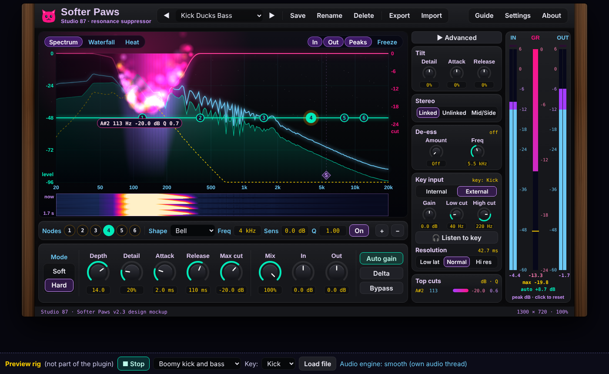

# Softer Paws

A free, open source dynamic resonance suppressor by **Studio 87**. It finds harsh, ringing frequencies while the music plays and turns them down only while they ring, so the sound gets softer and smoother without losing its character. Made for Linux first, with Windows and macOS builds planned.

## Status

Design stage. There is no plugin to download yet. The interactive mockup in `docs/mockup/index.html` runs the real sound engine in your browser: download the repo, open that file, press Play in the preview rig and turn the knobs. The VST3 plugin will be built from this mockup.

## What it does

- Finds and calms resonances across 20 Hz to 20 kHz, with Soft (adaptive) and Hard (fixed threshold) modes.
- Depth, Detail, Attack, Release and Max cut, plus Tilt of detail, attack and release across the spectrum.
- Up to 8 sensitivity nodes (Bell, Low shelf, High shelf, Low cut, High cut, Band pass, Notch, Tilt) to steer where it works.
- Built-in de-esser for S, T and SH sounds.
- Auto gain keeps the processed sound as loud as the input, so you judge tone, not level.
- Delta (hear only what is removed), Mix, stereo Linked, Unlinked or Mid/Side, external key (sidechain) input with Gain, Low cut, High cut and Listen to key, so a kick can duck a bass or a vocal can make room in a lead.
- Big live display: spectrum with the cuts, waterfall, heat map, and labels with note, frequency, cut and Q of the strongest resonances.

## Licence

AGPL-3.0-or-later, see [LICENSE](LICENSE). Fonts in `docs/mockup/fonts` are under the SIL Open Font License (files included).

This repository does not take issues or pull requests. You are welcome to fork it; forks are maintained by their owners.

If you like the work, you can support it on Ko-fi: https://ko-fi.com/studio87
